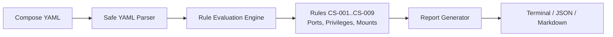

# Compose Scout

Security auditing and configuration hardening CLI for Docker Compose definitions.

[](https://github.com/AliSaleh07/compose-scout/actions/workflows/ci.yml)

## Core Capabilities

- **Privilege Auditing**: Flags `privileged: true`, host namespaces (`network_mode: host`, `pid: host`), and Docker socket mounts (`/var/run/docker.sock`).
- **Network Boundaries**: Identifies unrestricted `0.0.0.0` bindings on sensitive database ports (Postgres, MySQL, Redis, Mongo).
- **Secret Detection**: Catches inline plaintext passwords and tokens defined directly in `environment` directives.
- **CI/CD Integration**: Supports `--strict` mode (exit code `1` on High/Critical findings) and machine-readable JSON/Markdown exports.



## Rule Catalog

| Rule | Severity | Description |
|---|---|---|
| `CS-001` | HIGH | Public binding (`0.0.0.0`) on database or internal service ports |
| `CS-002` | CRITICAL | Privileged container flag enabled |
| `CS-003` | CRITICAL | Dangerous or excessive capabilities added (`ALL`, `SYS_ADMIN`) |
| `CS-004` | HIGH | Host namespace sharing (`network_mode: host`, `pid: host`) |
| `CS-005` | CRITICAL | Host Docker daemon socket mounted (`docker.sock`) |
| `CS-006` | MEDIUM | Service executing as root without unprivileged UID |
| `CS-007` | LOW | Missing CPU or memory resource constraints |
| `CS-008` | HIGH | Hardcoded plaintext credential in environment variables |
| `CS-009` | LOW | Root filesystem is writable (missing `read_only: true`) |

## Quickstart

```bash
python -m venv .venv
source .venv/bin/activate
pip install -r requirements.txt
pip install -e .
```

## Usage

```bash
# Audit a compose file
scout audit docker-compose.yml

# Automated CI pipeline failure on critical issues
scout audit docker-compose.yml --strict

# Machine-readable JSON output
scout audit docker-compose.yml --format json -o audit.json
```

## Running Tests

```bash
pytest -v tests/
```
---

## Safe Use & Security Disclaimer
*Compose Scout is an automated defensive static analysis tool developed strictly for authorized configuration auditing, security compliance reviews, and infrastructure hardening. It must only be used on Docker Compose files and infrastructure configurations you own or have explicit authorization to audit.*
